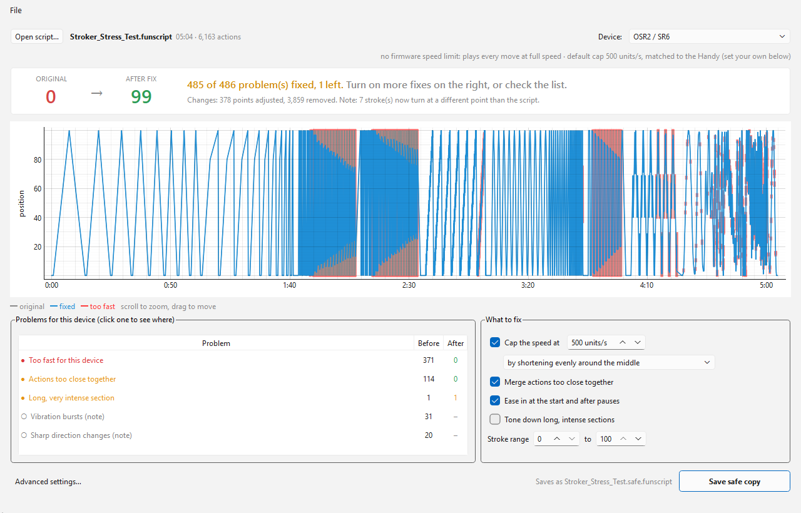
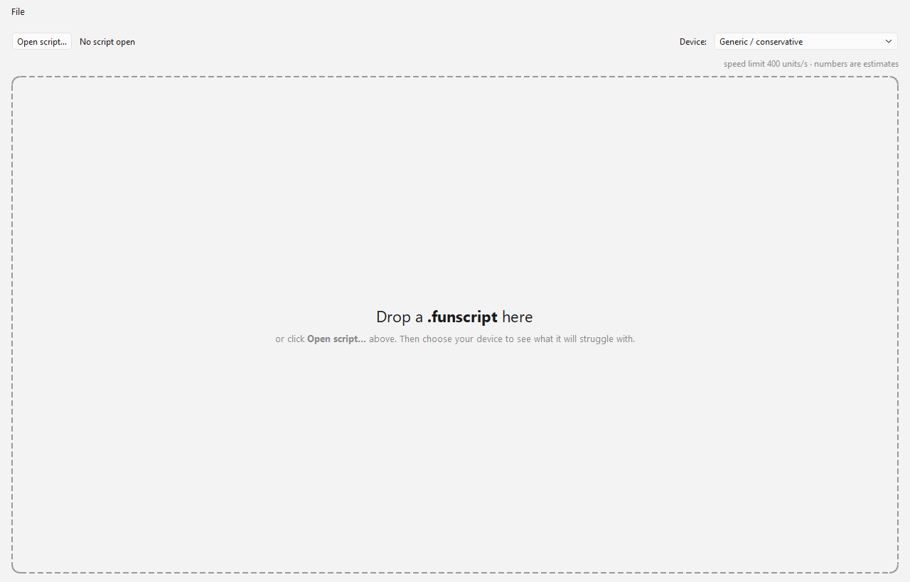
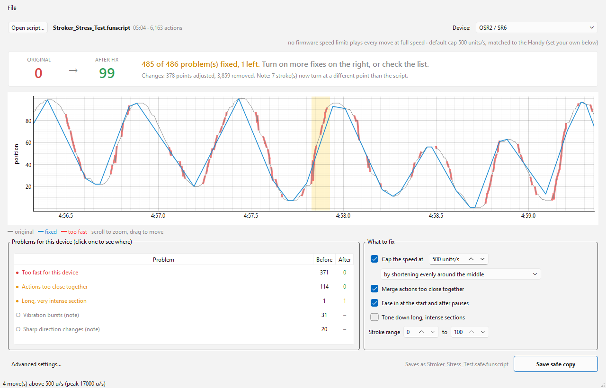
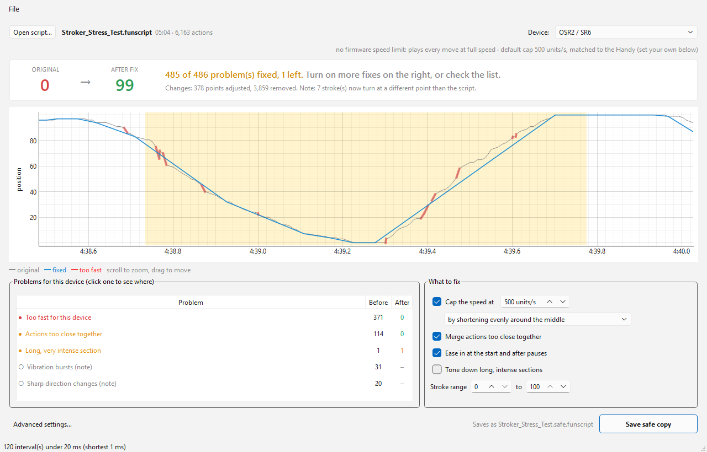
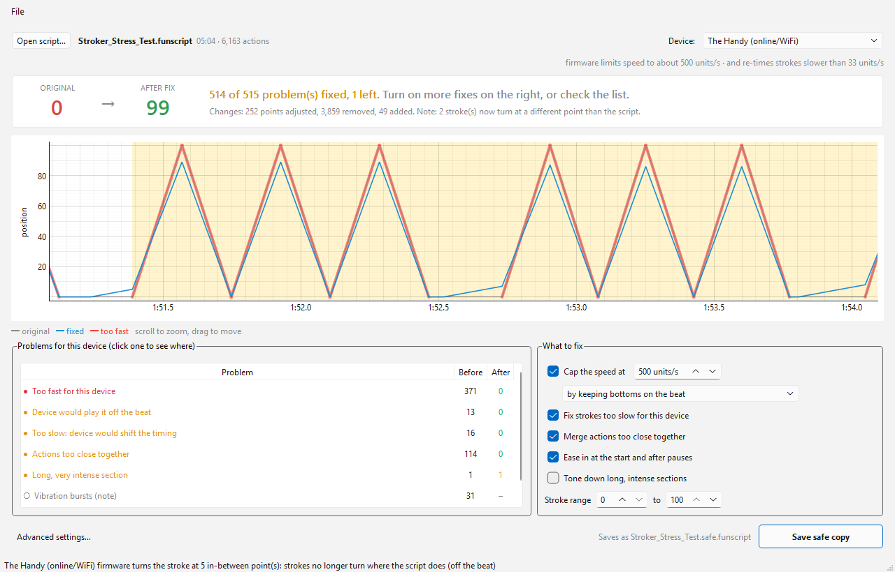
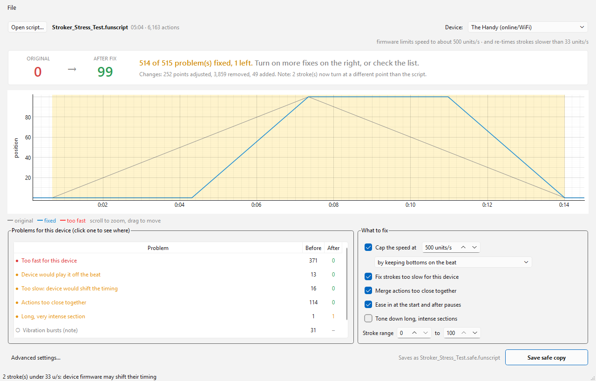
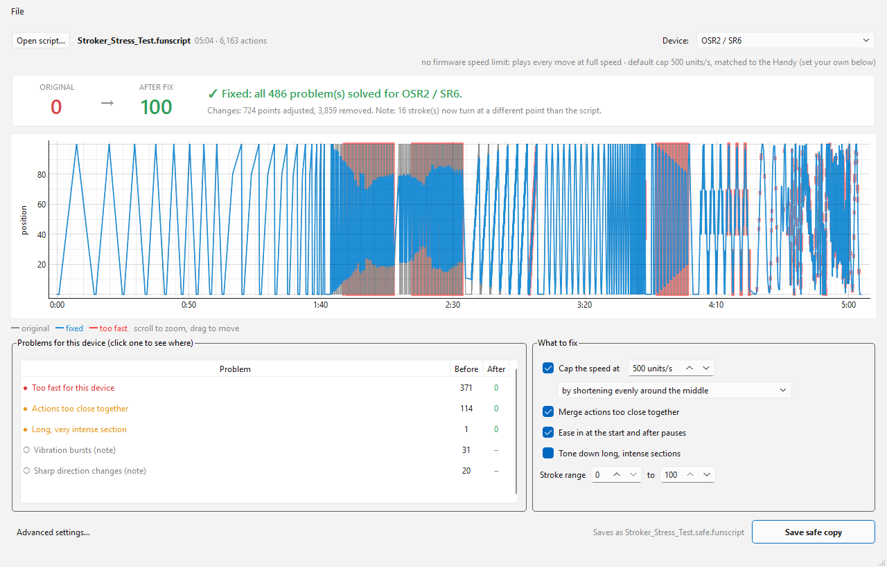
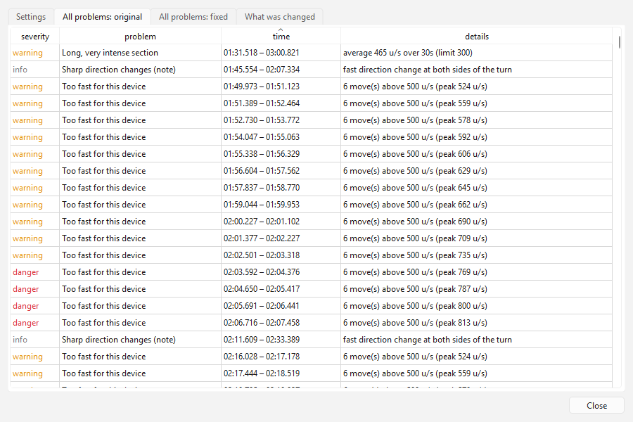

# Script Safety Manager

A local, offline desktop app that checks a `.funscript` **before you play it**, especially a new, untested one, and saves a copy your device can play safely.



> Status: working and tested on Windows. **Scope: single-axis (stroke) scripts only.** Multi-axis support is out of scope for now, but pull requests are welcome.

## Why this exists

More and more scripts are being released by new authors without being tested on real hardware. A script is just a list of positions and times. Nothing in the file stops it from asking for a full-length stroke in 5 ms, or hundreds of actions a second. What happens then depends entirely on your device.

**The Handy protects you by itself.** Its firmware caps speed (around 500 units/s in online mode) and rewrites anything faster before playing it. That behaviour has been tested thoroughly by forum members. For the Handy this app is mostly about *playing the script as intended*: the firmware's limiter can move beat-synced strokes off the beat, and it re-times very slow strokes.

**OSR2, SR6 and SSR1 do not.** They play every command as fast as their servos or motor can move. There is no firmware cap. A script with a 1 ms gap or a 17,000 units/s jump is executed at the device's top speed, so a careless or broken script becomes a full-power slam. For these devices this app is the safety layer: it finds those moves and caps them before the device ever sees them. The default cap is **500 units/s, matched to the Handy**, because that limit has been tested by the community. You can set your own.

| | The Handy | OSR2 / SR6 / SSR1 |
|---|---|---|
| Built-in speed limit | Yes, firmware (well tested) | **No**, moves at top speed |
| What an untested script can do | Play off the beat, or with shifted timing | Slam end to end at full power, rapid-fire jolts |
| What this app does | Fixes it so the firmware has nothing to rewrite | **Caps speed and removes jolts before playing** |

How devices react to extreme scripts, from community testing on EroScripts ([FUNSR1 vs the Handy](https://discuss.eroscripts.com/t/review-funsr1-in-action-beats-the-handy/157363), [Handy firmware blends slow actions](https://discuss.eroscripts.com/t/handys-firmware-blends-slow-actions/107231)):

| Device | Too fast | Too slow | Many tiny / in-between points |
|---|---|---|---|
| The Handy (online) | Firmware shortens the stroke toward its start (~500 u/s), which can move a beat-synced bottom so the stroke turns off the beat | Firmware shifts turning-point timing (~33 u/s) | Fine |
| The Handy (Bluetooth) | Plays at top speed, aborts when the next command arrives | Moves at its slowest speed, then waits | Skips actions; micro-stutters after every point |
| OSR2 / SR6 / SSR1 | **Plays at top speed**, aborts when the next command arrives | Plays as written | Fine (vibrations weaker on servo devices) |

## Install and start

Requires Python 3.10 or newer (developed on 3.14) on Windows.

```bash
git clone https://github.com/wilmgard/script-safety-manager.git
cd script-safety-manager
pip install -r requirements.txt
python -m script_safety.gui
```

You can also open a script directly: `python -m script_safety.gui "path/to/video.funscript"`.

## Using the app



1. **Open a script.** Drag a `.funscript` onto the window, or click **Open script…**.
2. **Choose your device** in the top-right dropdown. The line under it says what that device does with extreme moves, and whether its numbers are estimates.
3. **Read the verdict.** The two scores are how well the original plays on that device and how well the fixed copy will (0–100). The sentence beside them says how many problems were found and fixed.
4. **Look at the graph.**
   - Grey is the original, blue is the fixed copy, red marks moves that are too fast.
   - Scroll to zoom and drag to move.
5. **Check the Problems list.** It names each kind of problem in plain words, with how many there are **before** and **after** fixing. Click one to zoom the graph to it (highlighted in yellow). Click again for the next one.
6. **Choose what to fix** on the right. The defaults are the safe choice.
   - **Cap the speed at …** is your own speed limit. For OSR2 / SR6 / SSR1 it starts at 500 units/s (matched to the Handy); lower is gentler.
   - You can also pick how a too-fast stroke gets shortened:
     - **by keeping bottoms on the beat** (or tops): beat-synced points stay exactly where the scripter put them.
     - **by shortening evenly around the middle.**
     - **by shortening toward the start**, the way the Handy firmware does.
7. **Save safe copy.** It writes `NAME.safe.funscript` next to the original. The original is never changed. If you turn off the speed limit, the button and file name change to **modified** instead of **safe**.

**Advanced settings…** (bottom left) has every option, the full list of problems with exact times, and a log of what was changed.

## How the checks find the problems from the threads

These screenshots use `Stroker_Stress_Test.funscript`, the community stress-test script included in this repository. It was written to push devices to their limits, so it's a good stand-in for a badly made, untested script.

### Too fast for this device: the main danger on OSR2 / SR6 / SSR1

On an OSR the stress test has **371 places** where moves exceed the 500 units/s cap, peaking at **17,000 units/s** (the bottom-left status line shows the peak). An OSR would try to play every red segment at full servo speed. The blue line is the fixed copy: the same shape, never faster than the cap. After fixing: **0** too-fast moves.



### Actions too close together: jolts on servo devices

Here the original packs actions **1 ms apart** (the status line shows "shortest 1 ms"). A servo device jerks back and forth trying to follow, and the Handy over Bluetooth skips them. The fixed copy (blue) merges them into one smooth stroke and keeps its shape. After fixing: **0**.



### Device would play it off the beat: Handy firmware

This is the issue raised in the threads about the Handy's firmware: it shortens fast strokes from their start, which can pull a beat-synced bottom upward. An in-between point then becomes the new bottom, and the stroke no longer lands on the beat. The app simulates the firmware and flags these places (13 on the stress test).

With **keep bottoms on the beat**, the fixed copy (blue) keeps every bottom exactly in place and at full depth. Only the tops come down a little, so the firmware has nothing left to rewrite.



### Too slow: device would shift the timing (Handy firmware)

The Handy's firmware re-times strokes slower than about 33 units/s, so downstrokes no longer land when they should. The fixed copy holds briefly, then moves at the slowest speed the Handy plays correctly, so each point still arrives exactly on time.



### Everything on: all problems solved

With every fix switched on, including **Tone down long, intense sections**, the stress test goes from **0 to 100** on every device profile. All 486 problems are solved for OSR2 / SR6.



### Every problem with exact times

**Advanced settings… › All problems: original** lists each problem with its exact time and numbers. Click a row to see it on the graph.



### All checks

| Problem (as shown in the app) | What it means | Fix |
|---|---|---|
| **Too fast for this device** | Moves above the speed cap. Dangerous on OSR2 / SR6 / SSR1, which play them at full power | Cap the speed at … |
| **Actions too close together** | Gaps shorter than the device can follow: jolts on servo devices, skipped actions on the Handy over Bluetooth | Merge actions too close together |
| **Starts at full speed** / **Restarts at full speed after a pause** | The device jumps from rest straight into fast strokes | Ease in at the start and after pauses |
| **Device would play it off the beat** | (Handy online) the firmware's limiter would make strokes turn where the script doesn't | Keep bottoms (or tops) on the beat |
| **Too slow: device would shift the timing** | (Handy online) the firmware would re-time these strokes | Fix strokes too slow for this device |
| **Long, very intense section** | High average speed for 30 s or more: motor heat and fatigue, most relevant on devices that never slow down by themselves | Tone down long, intense sections (optional) |
| **File problem: …** | Positions outside 0–100, actions out of order, duplicate times. Files with unreadable values are refused when opening | Always cleaned up; saved positions are always kept within 0–100 |
| **Vibration bursts (note)**, **Sharp direction changes (note)** | Not dangerous, just how the device will play them | None needed (options under Advanced) |

## Recommended use for untested scripts

1. Open the script and pick **your** device.
2. If you see red **Too fast for this device** or **Actions too close together** on an OSR2 / SR6 / SSR1, the original would make the device move at full power. Don't play the original.
3. Leave the default fixes on and click **Save safe copy**.
4. Play the safe copy with the device's own stroke length and speed turned down the first time.

Because OSR-type devices don't limit themselves, check every untested script, even ones that look fine in an editor.

## Device profiles

| Device | Speed limit | Where the number comes from |
|---|---|---|
| The Handy (online/WiFi) | 500 u/s | Its own firmware limit, observed by forum members (also its ~33 u/s slow limit) |
| The Handy (Bluetooth) | 550 u/s | Estimate |
| OSR2 / SR6 | 500 u/s | **Self-defined safety cap**, matched to the Handy |
| SSR1 | 500 u/s | **Self-defined safety cap**, matched to the Handy |
| Kiiroo Launch / Keon, Vorze A10 Piston | 350–400 u/s | Estimates |
| Generic / conservative | 400 u/s | For unknown hardware |

OSR2, SR6 and SSR1 have no firmware limit, so there is no "real" number to measure that would make them safe. The cap is a choice. Because the goal is a safety layer, the default copies the Handy's 500 units/s, which the community has tested thoroughly. Change it at any time with **Cap the speed at …** in the app. A lower cap is gentler, a higher one is closer to the original script.

**Custom profiles:** put a JSON file in `%USERPROFILE%\.script_safety_manager\profiles\`, then choose **File › Reload profiles**. Fields you leave out come from `base`:

```json
{
  "base": "osr",
  "name": "My SR6 (gentle)",
  "max_speed": 300,
  "min_interval_ms": 30
}
```

Values are range-checked when loaded, so a bad profile can't switch the limits off.

## Scope

This app is for **single-axis (stroke) scripts**. Multi-axis files (`.roll`, `.twist`, `.pitch`, … for the SR6 and SSR1) open with a warning and are checked as if they were a stroke, which isn't meaningful. Multi-axis support isn't planned, because I don't own a multi-axis device to test with. Pull requests and contributions are welcome.

## What's been done

- **Research:** collected how the Handy (online and Bluetooth), OSR2/SR6 and SSR1 handle too-fast, too-slow and dense scripts from the EroScripts threads, and compared with existing tools (funscript.io has modifiers but no device-specific checks).
- **Checks:** too fast, too close together, hard starts and restarts, off-beat (by simulating the Handy firmware), too slow for the Handy, long intense sections, vibration bursts, sharp direction changes, and file problems. Each comes with a 0–100 score per device.
- **Fixes:** a speed cap with three shortening methods, including keeping bottoms or tops on the beat; merging close actions; ease-in; slow-stroke fix for the Handy; curve simplification for the Handy over Bluetooth; stroke range and invert; intensity cap.
- **Device profiles** for the Handy (online and Bluetooth), OSR2/SR6 and SSR1 (with a self-defined, Handy-matched cap), Launch, Keon, A10 Piston, a generic profile, and your own custom profiles.
- **Security hardening:**
  - broken or hostile files are refused;
  - bad profile values are rejected;
  - saved positions are always within 0–100;
  - the original file is never overwritten;
  - nothing is sent over the network;
  - saved files record what was changed, but no personal information.
- **Desktop app:** the one-screen workflow above, with your own speed cap, tested on Windows with the stress-test script.
- **Tests:** 54 automated tests, including hostile inputs, the cases from the threads, and a check that every device profile reaches zero problems on the stress test with all fixes on.

## What's next

1. **Windows installer:** a single `.exe`, so users don't need Python.
2. **Batch mode in the app:** check and fix a whole folder at once, with a summary of which scripts are unsafe.
3. **Profile editor in the app**, and an easy way to share profiles.
4. **Follow Handy firmware changes:** the Handy's official [firmware change logs](https://intercom.help/ohdoki/en/collections/10608301-change-logs) list each release. Add the firmware version a Handy profile was based on, and update its limits when a release changes them.

Not planned: multi-axis scripts (see [Scope](#scope)), measuring OSR2 / SR6 / SSR1 limits (the cap is self-defined), video preview and live device preview.

## Safety note

This app lowers the risk from badly made scripts, but it can't know your device's condition, its settings, or your limits, and the speed cap is a choice, not a guarantee. Especially on OSR2 / SR6 / SSR1: start with the device's own stroke length and speed turned down, keep its stop control or power within reach, and stop at once if anything feels wrong.

## For developers

Run the tests with `python -m pytest -q`. The safety logic lives in `script_safety/` (`analysis.py` checks, `fixers.py` fixes, `pipeline.py` order and options, `profiles.py` devices). The app in `script_safety/gui/` only displays it. The same logic is also available from the command line: `python -m script_safety -h`.
